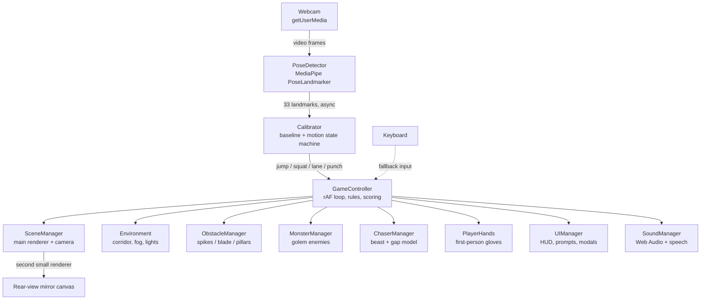

# ReflexRun 3D

<div align="center">


[](https://threejs.org/)
[](https://ai.google.dev/edge/mediapipe/solutions/vision/pose_landmarker)
[](https://vitejs.dev/)
[](LICENSE)

**A first-person endless runner you drive with your body — webcam in, three.js out, no controllers, no backend.**

`v0.1.0-prototype` · desktop Chrome / Edge · webcam required for motion play

</div>

---

## What it is

You stand in front of a webcam and run through an endless temple corridor. Jump over spike hurdles, duck under hanging blades, sidestep stone blockades, punch golems out of your lane — and keep a magma beast off your heels. Around ten thousand lines of HTML, CSS and JavaScript, no server, no accounts, no analytics, no asset pipeline: every mesh is a primitive, every sound is synthesized, every setting lives in `localStorage`.

The interesting part is the input layer. MediaPipe's pose model runs locally in WebAssembly/WebGL, a calibration pass learns your neutral stance, and a motion state machine turns shoulder movement and arm reach into game actions. Keyboard controls mirror the whole thing, so it is fully playable without a camera.

---

## My evaluation of the current build

Written from the inside, after building and testing it.

| | Assessment |
| :--- | :--- |
| **Does it run?** | Yes — boot → calibrate → run → pause → summary → restart, no console errors, no crashes in repeated sessions. |
| **Is it a game?** | Barely. One endless loop, four hazard types, three lives, a score. No levels, no progression, no bosses, no variety beyond a random shuffle of the same four hazards. |
| **Does the motion control work?** | Partly. The setup flow is now the strongest part of the project: it learns your guard stance, refuses to accept a hanging-arm pose as neutral, and requires four real moves before it will start. Whether the *thresholds* fit bodies other than mine is still unproven — I have only tested with synthetic landmarks and my own. |
| **Is it fun?** | Unknown. Nobody has played it long enough to say, including me — I can prove it functions, not that it's enjoyable. |
| **Does it look good?** | Passable, not good. The lighting rework (cool stone, warm firelight, environment probe) makes the corridor read and the enemies legible, but every object is still a box, cone or cylinder, and the first-person gloves are crude proxies. |
| **Is the code good?** | Mixed. The CV pipeline, chaser model and mirror renderer are clean and well separated. `GameController` (2,026 lines) is a god object that owns screens, rules, scoring, calibration flow and input. No types, no tests, no CI. |
| **How close to shippable?** | Far. Call it a solid tech demo that needs content, art, audio assets, real playtesting and a test suite before it deserves the word "game". |

**What holds up:** the calibration design (learn a guard stance, measure everything relative to it), the readiness gate that re-locks the stance before every run, the decoupled CV loop, and the rear-view mirror built on a second small renderer.

**What doesn't:** camera sensitivity to lighting and framing, punch detection from a single 2D viewpoint, and the absence of any tuning data from anyone but the author. Every UI and CV bug found so far was found by testing, not by reading the code — which means more are still in there.

---

## What works

- **Endless run loop** with distance, speed ramp, lives, combo scoring, persistent best score.
- **Four hazards**: spike hurdle (jump), hanging blade (duck), pillar blockade that seals 2 of 3 lanes (sidestep), golem enemy (punch in its lane).
- **The chaser**: a magma beast 12 m behind you that creeps closer while you run, lunges 3.4 m on every hit and is shoved back on clean clears. Visible in a rear-view mirror that runs its own WebGL renderer at ~30 fps.
- **Motion control** for jump, squat, sidestep and punch, with four sensitivity sliders.
- **Adaptive coaching**: hazard instructions slide in on a right-edge rail (never
  over the track, never in the middle of the screen), and stop being shown for a
  move once you have cleared it three times in a row. A miss re-arms the reminder
  for that move only. Settings offer Adaptive / Always / Off, and obstacle cues
  never speak — voice lines are opt-in and limited to run start, catch and finish.
- **Complete keyboard fallback** — choosing *Keyboard mode* switches body tracking
  off properly: the camera **stream is stopped** (so the camera light goes out),
  no pose inference runs, and the mode is remembered for later runs, so restarting
  with `R` or *Run Again* does not drag you back in front of the camera. A
  *Keyboard mode* badge sits where the camera preview would be, and you can switch
  back from the pause menu or by clicking the *Body tracking* card on the home
  screen.
- **Calibration + auto-start**: 3-step wizard — framing, guard stance, then **four real moves (jump, duck, dodge, punch)** which are simultaneously the start gesture: complete the set and the run counts down and begins by itself. No key press, and the same check re-runs before every camera run. Toggle in settings (*Auto-start with moves*).
- **Screens**: home, calibration, countdown, play, pause, workout summary, 6-step tutorial, settings.
- **Audio**: procedural percussion, SFX and speech prompts via Web Audio + `speechSynthesis`.
- **Performance tiering**: the pose model starts on `full` and steps down to `lite` when inference latency exceeds budget, or up to `heavy` when there is headroom (never before 20 real inference samples exist).

## What is missing

- Reaction-time measurement, collectibles, levels, bosses, leaderboards, accounts.
- Third-person view, mouse input, gamepad support, key remapping.
- Real art assets and real audio files — everything is generated. The 3D is flat
  low-poly primitives: readable after the lighting rework, but not attractive.
  The player's boxing gloves in particular are still crude proxy geometry.
- Mobile support (a responsive layout exists but is untested) and any accessibility pass.
- Tests, CI, linting, error reporting, telemetry.
- Any playtest data other than the author's own.

---

## Quick start

Requires Node.js 18+, a desktop browser with WebGL2, and a webcam for motion play.

```bash
git clone https://github.com/zaidan-contractor/REFLEX-RUN.git
cd REFLEX-RUN
npm install
npm run dev        # http://localhost:5173/
```

```bash
npm run build      # production bundle in dist/
npm run preview
```

First load downloads the MediaPipe runtime and pose model from CDNs
(`cdn.jsdelivr.net`, `storage.googleapis.com`), so it needs network access once.
The video stream itself is processed on-device and never uploaded.

For the best read: camera at chest height, 2–3 m back, front evenly lit,
full body or at least head-to-hips in frame, and enough room to step side to side.

---

## Controls

| Action | Body motion | Keyboard |
| :--- | :--- | :--- |
| Jump | shoulders rise above baseline | `W` / `Space` / `↑` |
| Duck | shoulders drop, knees bend | `S` / `↓` |
| Move left / right | lateral shift past the step threshold | `A` / `←`  ·  `D` / `→` |
| Punch | one arm extends forward, past your calibrated guard reach | `J` (left) · `K` / `F` (right) |
| Pause / resume | — | `Esc` |
| Mute | — | `M` |
| Start / restart | — | `Enter` / `Space` on the home screen, `R` in game |

No mouse input is used anywhere.

---

## Calibration, and why there's a guard stance

A single webcam gives 2D landmarks, so "neutral" has to be learned per person and per room rather than assumed. Every run starts with:

1. **Framing** — you must be centred, with a torso height between 0.16 and 0.62 in frame coordinates.
2. **Guard stance** — hold still for about 1.4 s (0.9 s on repeat runs) with **hands up near your chest, body straight**. That single pose becomes the baseline: neutral shoulder height, torso scale, shoulder width, hip position, and your resting arm reach. The hold only counts while the pose really is a guard: both wrists must sit above the hip line, closer to the shoulder than an arm's length, inside your shoulder width, and below head height. Stand there with your arms hanging and step 2 stays on `HANDS UP` with the hint "hands are too low", the progress bar never fills, the start button stays disabled and the run will not auto-start.
3. **Four moves = the start gesture** — jump, duck, dodge and punch, in any order. Each one lights its tile as it is detected, and when the fourth registers the run counts down (`3-2-1`) and starts **on its own**. There is nothing to click: the move set is both the tracking check and the "ready" signal. `START RUN` still works if you would rather skip it, and settings has *Auto-start with moves* on/off.

Steps 1–3 re-run before **every** camera run, shortened for returning players (600 ms framing, 900 ms guard hold). Dropping your hands during the guard hold cancels it and re-locks step 2; dropping them between moves keeps them counting but the hint asks you to put them back up. Previous baselines are thrown away — reusing one from an earlier session was the single biggest source of "the controls feel wrong" problems.

Capturing your resting reach is what makes standing still safe: a punch must clearly exceed the guard reach you calibrated, so hands at your chest can never register as a punch no matter your body proportions. The baseline may only be captured while you are genuinely still; a jump or a wave resets the hold.

Sensitivity sliders (jump, squat, sidestep, punch) let you retune the thresholds without recalibrating. Defaults: `12%` torso height, `14%`, `10%` shoulder width, `16%` reach scale.

---

## Rules and tuning constants

- **Lanes** at `x = -2.8 / 0 / +2.8`. Run speed ramps from `10.5 m/s` to `18 m/s` (about 38 → 65 km/h).
- **Hazard mix**: 35% spike hurdle, 35% hanging blade, 30% pillar blockade. Spacing starts near 24 m and tightens toward 18 m as you travel.
- **Clean clear** +150 points, beast pushed back `0.9 m`.
- **Golem punched** +250 points, beast pushed back `1.8 m`.
- **Hit** −1 of 3 lives, combo reset, beast lunges `3.4 m`.
- **Beast closes to 2.2 m** → run over immediately.
- **Combo** multiplier rises every 4 combo steps, caps at ×8, expires after 3.5 s without a clear.
- **Cue coaching** flips a move to "learned" after 3 consecutive clean clears
  (stored in `reflexrun_coach`), and back to learning on any miss.
- Persisted in `localStorage`: `reflexrun_best_score`, `reflexrun_last_run`,
  `reflexrun_game_settings` (mirror, voice, cue mode, auto-start), `reflexrun_motion_settings`
  (sensitivity), `reflexrun_coach` (which moves you have learned).

---

## Architecture



Three decisions worth knowing:

- **Pose inference is asynchronous and decoupled from the render loop.** A slow inference frame never stalls 60 fps rendering; `PerformanceMonitor` swaps model tiers based on measured latency.
- **The chase is a distance model, not physics.** A single `gap` value creeps closed, lunges on hits and gets pushed back on clears. It is readable, tunable, and easy to reason about — the beast has no collision body.
- **The mirror is its own `WebGLRenderer`.** Rendering a scissored pass into the main canvas was tried first: it flickered between frames and was smeared by the HUD panel's `backdrop-filter`. A separate 300×150 canvas costs ~0.8 ms per frame and is always correct.

---

## Repository layout

```
reflex-run/
├── index.html                   # all screens live in one document
├── package.json                 # vite + three + @mediapipe/tasks-vision
├── vite.config.js
├── public/                      # favicon and icon sprite only
└── src/
    ├── main.js                  # bootstraps GameController
    ├── style.css                # ~3.1k lines of hand-written CSS
    ├── cv/
    │   ├── PoseDetector.js      # MediaPipe wrapper, model tier loading
    │   ├── Calibrator.js        # baseline, thresholds, motion state machine
    │   └── PerformanceMonitor.js# latency/FPS telemetry, tier switching
    ├── game/
    │   ├── GameController.js    # screens, loop, rules, input, calibration flow
    │   ├── SceneManager.js      # renderer, camera, rear-view mirror
    │   ├── Environment.js       # corridor geometry, materials, lighting
    │   ├── ObstacleManager.js   # hazard generation and collision windows
    │   ├── MonsterManager.js    # golem enemies
    │   ├── ChaserManager.js     # the beast: rig, animation, gap model
    │   └── PlayerHands.js       # first-person gloves
    └── ui/UIManager.js          # HUD, action prompts, modals, summary
```

## Code health

~11,000 lines total, ~6,500 of them JavaScript, no TypeScript, no tests, no CI,
no linter config.

- `GameController.js` — 2,026 lines and the main liability: screen state machine, game rules, scoring, input routing, the calibration flow and now the start-sequence gating in one class.
- `Calibrator.js` — 1,122 lines of heuristics. Well-commented, but the thresholds are tuned by hand and there is no test coverage on the state machine.
- `style.css` — 3,697 lines, no preprocessor, no design tokens beyond CSS variables, and it grew by ~570 lines of overrides during the last two UI passes, which is a smell.
- Dead weight has been removed, but there is no automated check that keeps it that way.

---

## Testing status

There is no test suite. Functionality was verified with scripted browser automation against the dev server: injecting synthetic pose data into `Calibrator.processFrame`, asserting screen transitions and DOM state, driving full runs with the keyboard, and reading pixels back from the WebGL canvases to confirm the beast is actually visible in the mirror. Plus manual smoke passes over the whole flow.

**Not verified:** real people, other rooms and lighting, other browsers, mobile, low-end GPUs, long sessions, accessibility, or the model-tier switching under sustained load. Treat any motion-control tuning as provisional until it has been tried on more than one body.

If you file a bug, include browser version, camera, lighting and what your body was doing — "it didn't work" is not actionable for a CV game.

---

## Roadmap, in priority order

1. **Playtest with real people** and log which moves are misread — every threshold in this repo is currently a guess.
2. **Tests for the calibrator state machine**, then CI on push.
3. **Static deploy** (GitHub Pages) so it is playable without `npm install`.
4. **Content**: hazard patterns, a real difficulty curve, a second chase phase.
5. **Art and audio**: replace primitives and synthesis with actual assets.
6. **Mobile / responsive pass**, or an explicit desktop-only gate.
7. **Accessibility**: key remapping, labelled controls, no-camera parity for every screen.

Issues and PRs are welcome, but expect churn — internal APIs change without notice and there are no tests to protect you.

## License

GNU General Public License v3.0 — see [LICENSE](LICENSE).
